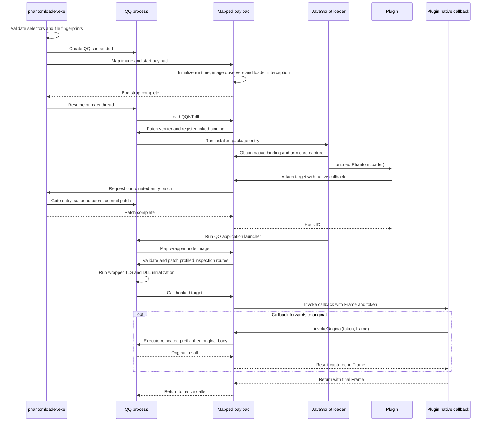

<!-- SPDX-FileCopyrightText: 2026 movblock -->
<!-- SPDX-License-Identifier: CC-BY-4.0 -->

# Native runtime architecture

PhantomLoader obtains control before QQNT's application startup by creating QQ suspended and manually mapping its native payload before the primary thread resumes. The launcher, `phantomloader.exe`, coordinates this startup, while `phantomloader_payload.dll` supplies the verifier patch, main-process native binding and capture guard inside QQ. Once the JavaScript loader starts, plugins can install native hooks before it hands control to QQ's application launcher, establishing the execution order shown below.

This guide explains the runtime's structure and the reasons behind its main design choices, with source references for details better understood directly in code. [Native hooks for plugins](../docs/native.md) provides the complete plugin example and API contract, while [the distribution reference](../docs/distribution.md) describes installation and packaging.

## Startup and plugin hooks



Because the native binding exists before plugin initialization, a plugin can attach a hook during `onLoad` and intercept subsequent calls from QQ's application. Calls completed earlier in startup cannot be intercepted retroactively, and a plugin targeting a later-loaded module must wait until that module becomes available.

The launcher remains alive to coordinate later entry changes and monitor QQ's exit, although the payload and plugin callbacks execute entirely inside QQ. This process boundary keeps patch coordination outside the application threads and locks whose behavior may itself be affected by an installed hook.

## Components

The [Cargo workspace](Cargo.toml) divides these responsibilities among four crates, separating process control, in-process execution, shared definitions and the embedding of the hook backend.

| Component | Responsibility |
| --- | --- |
| [launcher](crates/launcher/src/lib.rs) | Validate the installation, create QQ, map the payload, coordinate patches and monitor exits. |
| [payload](crates/payload/src/lib.rs) | Intercept startup, register the binding, manage hook lifetimes and capture DLVM programs. |
| [platform](crates/platform/src/lib.rs) | Share bootstrap/coordinator ABIs and generate typed compatibility-profile constants. |
| [neohook-embed](crates/neohook-embed/src/lib.rs) | Own generated hook code, relocation maps and unwind registrations, using the payload's Windows callbacks. |

The payload's `neohook` dependency refers to the local embedding crate, which delegates target resolution, iced-x86 relocation and unwind-code translation to prepared upstream NeoHook. Installation and reporting remain outside this workspace, with distribution scripts modifying the package entry and presenting capture reports after the QQ process exits.

## Getting control before QQ's application starts

[Launcher startup](crates/launcher/src/lib.rs) validates the selected installation against [the compatibility profile](../distribution/profile.json), starts the patch coordinator and creates QQ with its primary thread suspended. Validation retains file handles until QQ resumes, preventing the checked startup files from being replaced during injection; the exact checks are defined in [target.rs](crates/launcher/src/target.rs).

The launcher then maps the payload, supplies its bootstrap context and starts a remote bootstrap thread, as implemented in [process.rs](crates/launcher/src/process.rs). QQ's primary thread resumes only after successful payload initialization; if startup fails while the child remains suspended, the launcher terminates that child.

Inside QQ, mandatory image observers apply the profiled wrapper inspection patches before its mapping call returns, preceding normal loader TLS callbacks and DLL initialization. The payload also wraps the executable's library-loading imports so that loading `QQNT.dll` triggers the profiled verifier patch and native binding registration. The resulting `phantomloader_native` binding, also available as `liteloader_native`, provides the native facilities needed when QQ evaluates the installed JavaScript package entry.

From there, [src/main.js](../src/main.js) installs Electron transport and preload support, arms core capture, initializes plugins through synchronous `onLoad` calls, and starts QQ's application launcher. For the native interception itself, [loader.rs](crates/payload/src/loader.rs) is the direct reference; plugin discovery and JavaScript lifecycle dispatch remain in the JavaScript loader.

## Build-specific inspection patches

The compatibility profile selects three wrapper routes: signing-stack classification, disk-versus-memory code comparison, and handle/name inspection. Their patches retain the existing signing continuation, use the checksum collector's disabled path, and construct a valid empty handle result. Other environment collection and authentication work remain in place.

[protection.rs](crates/payload/src/protection.rs) installs observers for `NtMapViewOfSection` and `NtMapViewOfSectionEx` during payload bootstrap, independently of the capture setting. It validates the complete patch set before writing to a newly mapped matching executable image and terminates on a guard or write failure. Non-executable image views used for file inspection retain their original bytes and protections. Observing the mapping return provides an earlier boundary than `LdrLoadDll` return, while avoiding external-module calls from a DLL notification callback.

Plugins can still hook both mapping APIs. Attachment resolves to the resident observer, so forwarding through `invokeOriginal` completes the native map and profile processing before returning the mapped image to the callback. Detaching a plugin hook retains the mandatory observer. Direct system calls, custom loaders and other paths bypassing these observers are outside this installation contract; the exact routing is clearer in [managed.rs](crates/payload/src/managed.rs).

These changes target verified routes in the selected QQNT build. They do not conceal changed pages or prevent another routine from inspecting them, and require fresh analysis and validation when QQNT or its loading behavior changes.

## Why the payload is manually mapped

Manual mapping keeps the payload out of the Windows loader's module list, so enumeration through `K32EnumProcessModules` does not return it as a loaded DLL. Although `LoadLibrary` would simplify loading, it would register the payload in that list; the launcher instead copies it into private memory and initializes it explicitly.

This choice transfers relocation, page protection, bootstrap API resolution and unwind registration from the Windows loader to the launcher and payload, increasing their implementation responsibilities. The import-free, CRT-free payload and explicit [bootstrap context](crates/platform/src/context.rs) keep those responsibilities bounded, while the launcher itself remains an ordinary Windows executable. The corresponding code is best followed in [image.rs](crates/launcher/src/image.rs), [process.rs](crates/launcher/src/process.rs) and [runtime.rs](crates/payload/src/runtime.rs), where the mapping and initialization steps are implemented.

Plugins use the same resident hook engine, so attaching a hook creates private gateway and trampoline code without loading an additional hook-engine DLL. A callback helper loaded separately through `require("helper.node")` remains a registered DLL, however, because using the payload's hook engine does not alter the helper's loading path.

## Inspection limits

Manual mapping provides a narrow concealment property: the payload and generated hook code are absent from ordinary Windows loader module enumeration, including `K32EnumProcessModules`. The platform does not conceal the surrounding memory, execution state or operating-system objects, so the following inspection methods remain applicable.

| Inspection method | Observable platform state |
| --- | --- |
| `VirtualQuery` / `NtQueryVirtualMemory` | Private mappings, executable allocations, page protections and memory-region metadata. |
| Prologue and executable-section comparisons | The verifier patch and installed inline entry patches. |
| IAT validation | The executable's library-loading interception and any other modified import entries. |
| Working-set inspection | Page residency and sharing state, including private copies of modified image pages. |
| `RtlLookupFunctionEntry` / function-table inspection | Registered payload and trampoline unwind metadata. |
| Call-stack inspection | Dispatcher, callback and trampoline execution, including relevant frames and return addresses. |
| `NtQueryInformationThread` | Thread information and start addresses associated with runtime activity. |
| VEH inspection | The resident breakpoint handler and its routing state. |
| PEB and loader-state inspection | Process and loader bookkeeping beyond the absence of a payload module entry. |
| IPC and handle inspection | The launcher coordinator, its communication channel, events, threads and handles. |

These are documented limits of the current modding platform, independently of whether a particular QQNT build actually uses each method to detect modifications. The build-specific patches cover the three profiled wrapper routes described above. The capture guard covers its profiled DLVM receipt and execution paths, while telemetry controls address their own reporting routes. Other implementations of these inspection methods remain outside that coverage.

Every QQNT update requires binary re-analysis because a new build can add user-mode anti-cheat or change the activation of an existing inspection path. Preserved binaries and analysis databases support incremental comparison, but relocated hook sites, matching prologues and successful launches establish functional compatibility without resolving those detection questions.

## Installing a hook

When a plugin requests attachment, the binding resolves aliases, checks for conflicting hooks and prepares an entry patch together with an original-call trampoline. Preparation relocates complete instructions covering at least five bytes into nearby executable memory, then appends a continuation jump without changing the target's live entry.

For managed hooks, the prepared entry transfers control through a gateway into the resident dispatcher, while original calls execute the relocated prefix before continuing through the source body. The gateway, trampoline and generated unwind metadata share one allocation, whose lifetime is retained by the managed ownership described in the next section. Target selection remains the plugin author's responsibility under [the API contract](../docs/native.md#choosing-a-patchable-target), because the backend's bounded branch scan cannot establish that the overwritten prefix is single-entry.

Activation occurs in a separate transaction, during which the payload closes an entry rendezvous and asks the external coordinator to modify the target. Since Windows permits threads that bypass a process freeze, the coordinator also installs a temporary entry INT3, snapshots peers and explicitly suspends them before committing. Threads that bypass the freeze encounter the resident breakpoint rendezvous, which holds their entry until coordination completes; ordinary hooked calls subsequently use jumps and calls.

If coordination fails before commit, it restores the previous state before resuming peers; an uncertain failure after entry becomes reachable terminates QQ to avoid continuing with unknown native state. Detach uses the same transaction machinery to restore the target and redirect stopped gateway executions into resident code before generated ingress can be reclaimed.

Read [launcher/coordinator.rs](crates/launcher/src/coordinator.rs) together with [payload/coordinator.rs](crates/payload/src/coordinator.rs) for the transaction, and [hooks.rs](crates/payload/src/hooks.rs) for its connection to [InlineHook](crates/neohook-embed/src/inline.rs). The request layout, rollback steps and individual context edits are clearer in those implementations than in a parallel prose account of each operation.

## Calls, cleanup and reclamation

Each admitted callback or original call holds an execution reference, allowing the dispatcher to retain generated code throughout native execution and Windows exception unwinding. The dispatcher captures arguments in a `Frame` and restores the callback's result for the caller, while original-call capabilities permit forwarding without exposing raw trampoline addresses.

Detach prevents new callback admissions, but existing executions and original capabilities continue retaining the generated code until they return, unwind or release their ownership. Environment cleanup additionally revokes independent capabilities and waits for application work outside its enclosing native stack, while enclosing calls and internal executions finish under existing references. Consequently, callback code and data may need to outlive the Node environment that installed them, as specified in [the shutdown contract](../docs/native.md#detach-and-shutdown).

Two TLS slots distinguish callback suppression from application executions on the current native stack, enabling internal calls to bypass callbacks without allocation or recursive registry locking. The coordinator also retains scoped original leases for transport and wait providers, allowing coordination to complete even when a plugin hooks those same functions.

Once a detached hook has no remaining references, reclamation unregisters its unwind table and frees the allocation before publishing drain completion to its observers. Application releases can reclaim directly, whereas internal releases notify a resident worker; small routing descriptors and breakpoint events remain available for delayed arrivals in resident code. Context copies held by external code acquire no ownership, so their lifetimes remain outside this accounting and are constrained by the API's saved-continuation contract.

Generated trampoline tables use Windows unwind version 2 because version 1 can misidentify the continuation jump as a tail-call epilogue and omit source frame operations. Read [unwind.rs](crates/neohook-embed/src/unwind.rs) for that translation, [managed.rs](crates/payload/src/managed.rs) for lifetime transitions, and [dispatch.rs](crates/payload/src/dispatch.rs) with [dispatch.s](crates/payload/src/dispatch.s) for argument forwarding and unwind handlers. The remaining suppression, stack-tracking and worker mechanisms are grouped in [reentry.rs](crates/payload/src/reentry.rs), providing a focused starting point for changes to internal execution behavior.

## DLVM capture and reporting

Before plugins initialize, core JavaScript startup verifies the wrapper's on-disk fingerprint, prepares the capture directory and asks the native binding to arm the guard. The guard observes `LdrLoadDll` and validates the already-loaded or newly loaded wrapper against the compatibility profile before attaching its receipt and execution hooks.

When those hooks encounter a matching program, they save its raw bytes and JSON metadata, then terminate QQ before the intercepted work can continue. Because the capture hooks and state belong to the process, they survive Node environment cleanup and are reset only by starting a new process.

The launcher responds to capture success (`0xD1500001`), dump failure (`0xD1500002`) or arming failure (`78`) by starting the independent PowerShell reporter after QQ exits. That reporter selects captures by process identity and lifetime, prepares an archive and offers a browser issue for manual submission, treating captured programs as data throughout.

Read [src/main/capture.js](../src/main/capture.js) for core arming, then [capture.rs](crates/payload/src/capture.rs) and [foreign.rs](crates/payload/src/foreign.rs) for the guard and profiled task access. The post-exit path continues through [monitor.rs](crates/launcher/src/monitor.rs) into [Incident.Common.psm1](../distribution/Incident.Common.psm1), whose source defines capture selection and archive validation.

## Compatibility data and build dependencies

[distribution/profile.json](../distribution/profile.json) binds the runtime to a QQNT build by recording file fingerprints, native sites, expected bytes, foreign layouts and the capture-related constants. [platform/build.rs](crates/platform/build.rs) generates Rust definitions and hashes the exact profile bytes, so both native binaries and their package must be rebuilt together when the profile changes.

NeoHook and iced-x86 are reconstructed from pinned archives and checked-in patches recorded in [patches/dependencies.json](patches/dependencies.json), rather than maintained as complete vendored source trees. [prepare-dependencies.ps1](prepare-dependencies.ps1) verifies those inputs and reconstructs generated sources under ignored `build/dependencies`; dependency changes therefore belong in the checked-in patches rather than the prepared trees. The iced-x86 formatting patch avoids a CRT unwind dependency by retaining formatting within the payload's aborting-panic dependency graph, while [licenses](licenses) preserves third-party notices.

## Building and running

Use stable Rust with the Windows x86-64 MSVC target and Visual Studio C++ build tools, then build both binaries from the repository root:

```powershell
npm run build:native
```

The build prepares dependencies before producing `native/build/rust/release/phantomloader.exe` and `phantomloader_payload.dll`; run `./native/prepare-dependencies.ps1` separately before opening Cargo in an IDE or invoking it directly. Offline builds use `./native/build.ps1 -Offline`, with `-ArchiveDirectory` selecting a populated cache; [build.ps1](build.ps1)'s parameters also expose package, feature and output-directory overrides.

Corresponding source is available through GitHub's **Source code** downloads for the same release tag. Rebuild the workspace and package it with `npm run package` to produce an installable replacement runtime; the release builder accepts `-NativeBuildDirectory` for binaries built into a separate output directory.

To inspect the compiled profile or validate an installation without launching QQ, invoke the launcher with one of these commands from the repository root:

```powershell
native/build/rust/release/phantomloader.exe -profile-hash
native/build/rust/release/phantomloader.exe -exe "C:/Program Files/Tencent/QQNT/QQ.exe" -check
```

For normal operation, use the installed launch script or shortcut, which supplies the distribution configuration while the launcher remains alive for hook coordination. Argument handling is defined in [cli.rs](crates/launcher/src/cli.rs), installed configuration is described in [the distribution reference](../docs/distribution.md), and payload diagnostics are written to `%TEMP%/PhantomLoaderQQNT.log`.
